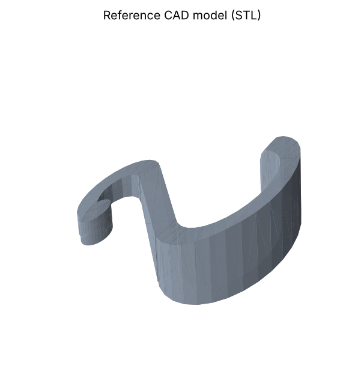
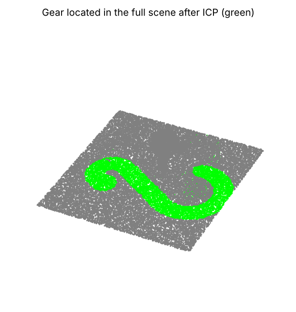
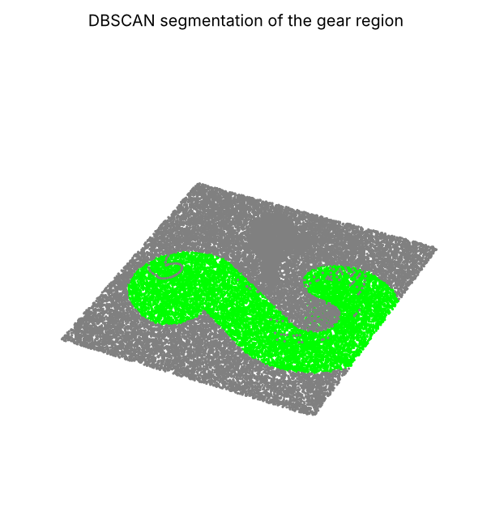
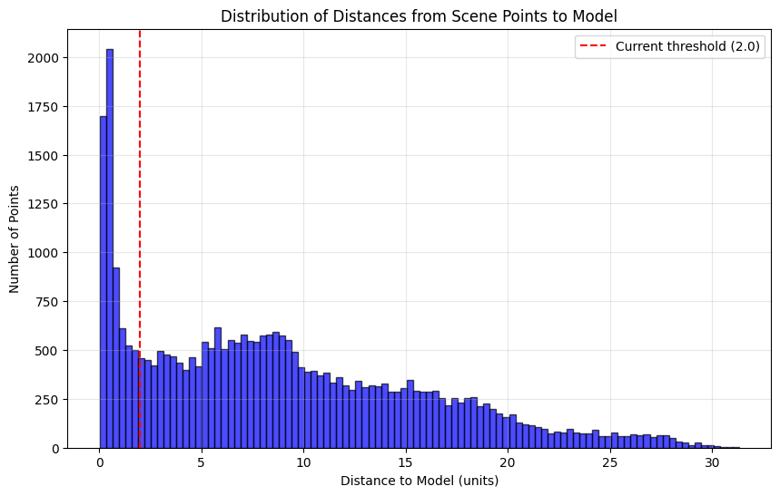
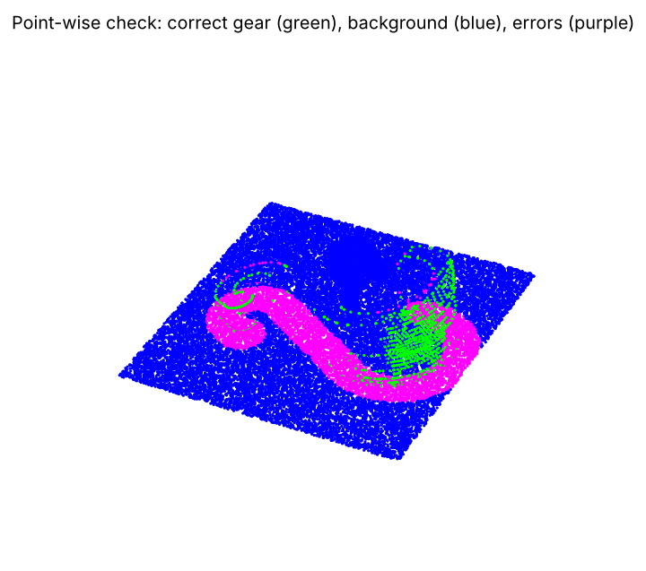

# Point Cloud Defect Detection with CAD Registration

University of Koblenz, Research Lab (M.Sc. Web and Data Science), 10/2025 – 02/2026

The goal of this project was to find a manufactured part inside a noisy 3D scan and decide which of its points belong to a defect. The pipeline uses the part's CAD model (STL) as a reference. It aligns the model to the scan, separates the part from the background, and then classifies points as OK or defective using local geometric features.

Everything is written in Python with Open3D, NumPy, SciPy and scikit-learn, in one notebook organised into three milestones.

<p align="center">
  
  
</p>

## Pipeline

**Milestone I: loading and registration**
- Load the raw scene scan (about 31,000 points) and the labelled training files (OK, defect, background) from CSV, and drop invalid rows.
- Sample 5,000 points from the STL mesh so the model and the scan can be compared point to point.
- Compare bounding boxes to check scale, then do a coarse alignment by moving and scaling the model to the scan's centre.
- Refine the alignment with point-to-point ICP (Open3D) and find the part in the full scene by distance to the aligned model.

**Milestone II: foreground/background segmentation**
- Look at the distribution of scene-to-model distances (histogram and percentiles) to choose a threshold based on the data instead of guessing one.
- Compare two methods: a plain distance threshold, and DBSCAN clustering in the region around the model.
- Score both methods point by point against the labelled data using KD-trees (precision, recall, F1).
- Wrap the result in a reusable `segment_foreground_background()` function with both methods.

**Milestone III: defect detection**
- Compute 7 local features for each point from its neighbourhood: density, distance variance, and features based on PCA eigenvalues (surface variation, linearity, planarity, sphericity).
- Train a class-balanced random forest on the labelled OK and defect points, with standardised features.
- Combine the classifier with a geometric rule that flags points more than 3σ from the CAD surface.
- Group detected defects with DBSCAN and evaluate them against the ground truth.

<p align="center">
  
  
</p>

## Results

| Step | Result |
|---|---|
| Coarse alignment | mean scan-to-model distance 4.30 (scale factor 1.05) |
| Part detection after ICP (point-wise vs. labels) | 82.0% accuracy, 92% of part points found, but 5,495 background points also marked as part |
| Segmentation: distance threshold | F1 0.09 |
| Segmentation: DBSCAN | recall 0.72, precision 0.07, F1 0.13 |
| Random forest on labelled points (training set) | 98% accuracy, defect recall 1.00 |
| Defect detection on the segmented scan | no defects found |

<p align="center">
  
</p>

## What I learned and what I would do next

The registration and segmentation steps work, but the numbers show clear limits, and I think that is worth stating honestly:

- **The registration starts from a rough guess.** Centring and scaling followed by ICP can settle in a local minimum, and the error plot shows part of the alignment is off. Next step: a global registration (FPFH features with RANSAC) before ICP.
- **Segmentation is too generous.** Most errors are background points close to the model. A tighter threshold chosen on a validation split, or a learned classifier for foreground vs. background, should raise precision.
- **The defect classifier was only evaluated on its own training data.** The 98% is a training score. On the scan, the features of the segmented points did not look like the training defects, so nothing was flagged. Next steps: a proper train/test split, cross-validation across several scans, and features that are more robust to point density.

## Run it

```bash
pip install -r requirements.txt
jupyter notebook point_cloud_defect_detection.ipynb
```

The dataset was provided by the course and is not included. Put it in `data/5/` (`data.csv`, `5.stl`, `obj_ok.csv`, `obj_defect.csv`, `background.csv`) or change `DATA_DIR` in the first code cell. The interactive 3D views were removed from the saved notebook to keep it small; the figures above are rendered from them.

## Tech

Python · Open3D (point clouds, ICP registration) · NumPy · SciPy (cKDTree) · scikit-learn (DBSCAN, RandomForestClassifier, StandardScaler) · Matplotlib

---
Prembabu Chandrababu · [LinkedIn](https://www.linkedin.com/in/prembabu-chandrababu-a26972219) · prembabu208@gmail.com
